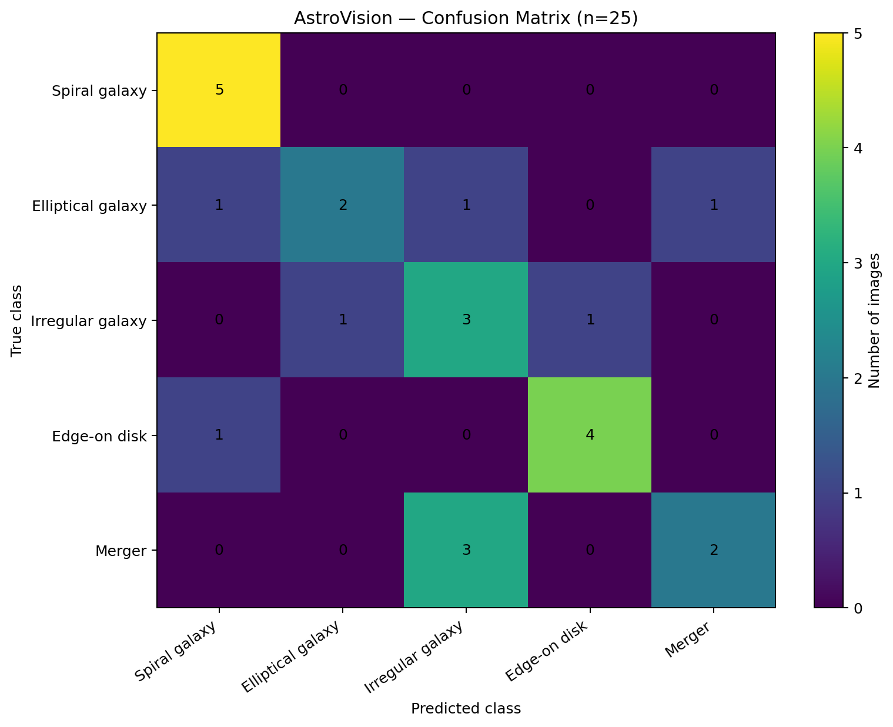
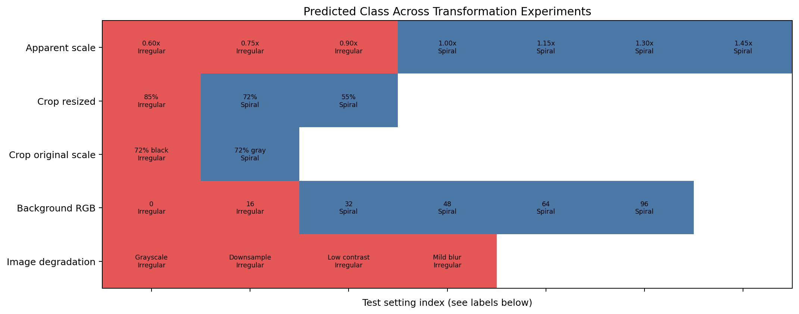
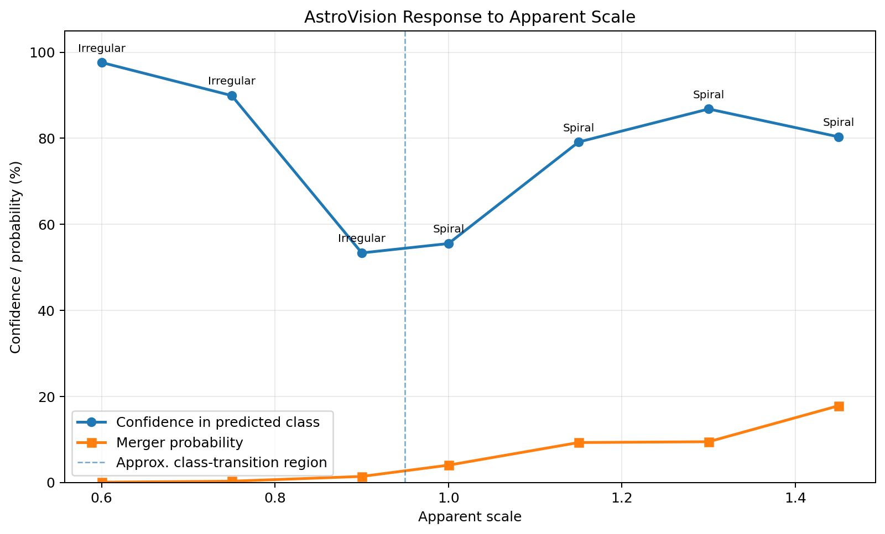
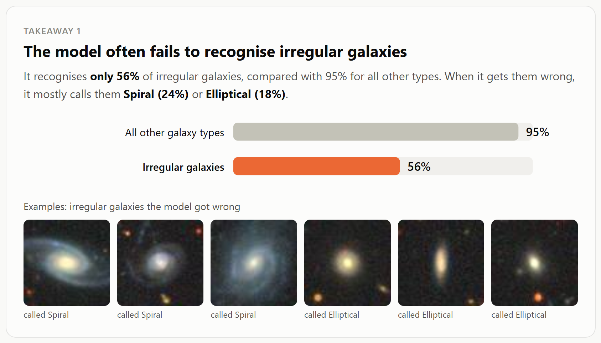
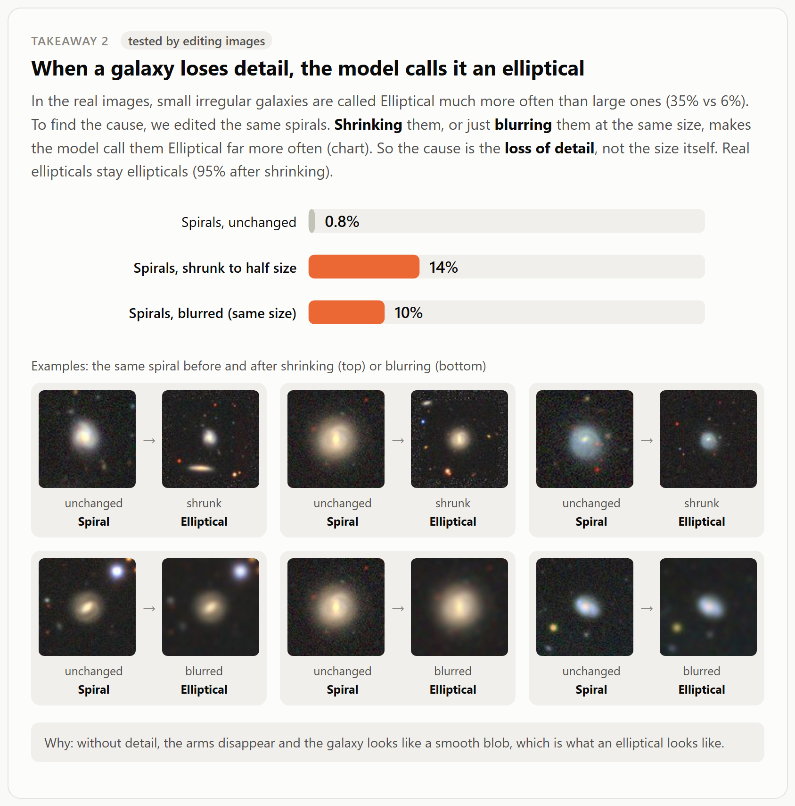
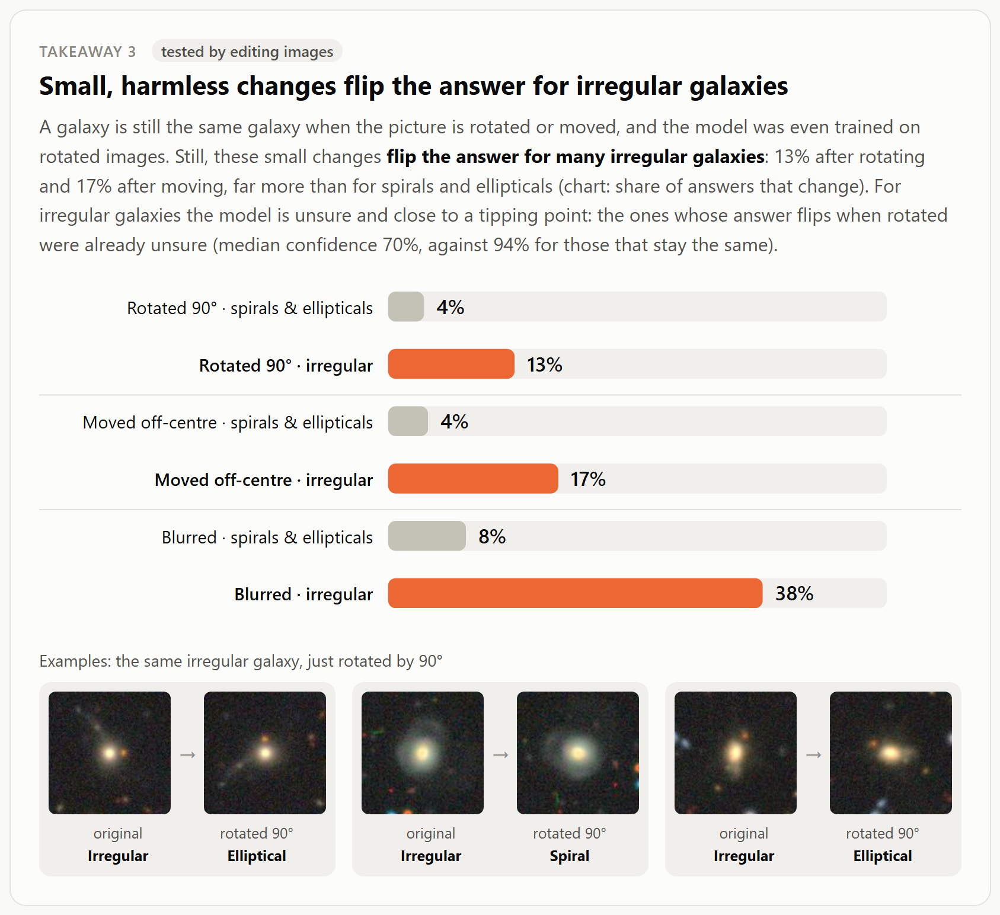
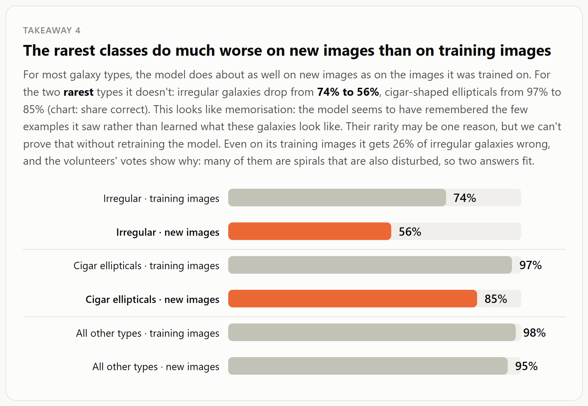
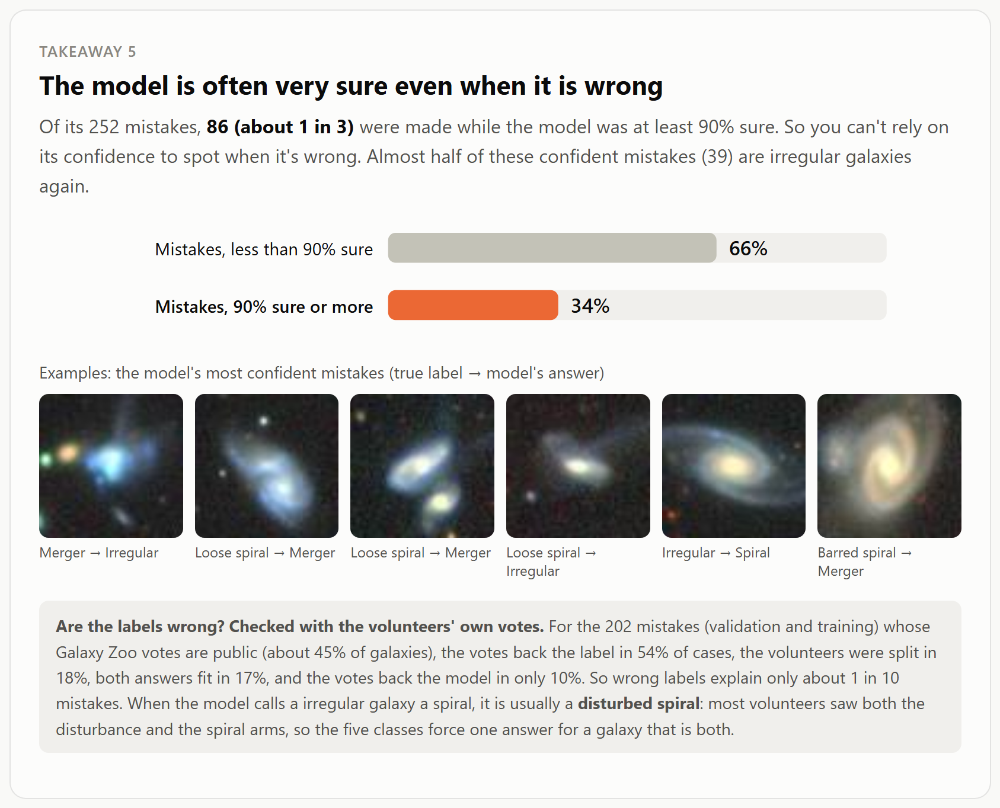
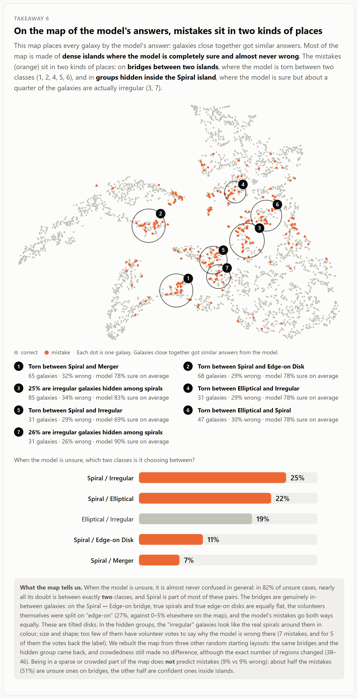
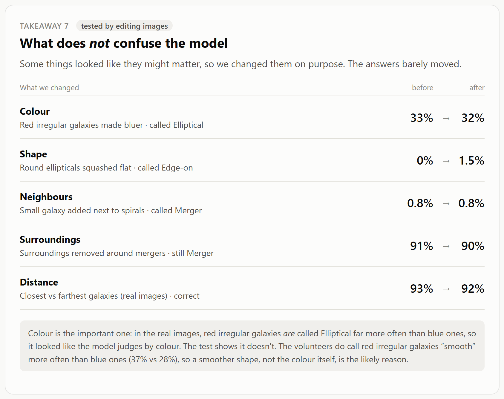

# Phase I: How does the model behave? (AI-aided pair)

**Model.** [zev-walker/astrovision-advanced](https://huggingface.co/zev-walker/astrovision-advanced) is a Zoobot (ConvNeXt-Nano) image classifier. It was fine-tuned on Galaxy10 DECals and sorts galaxy images into five classes: Spiral, Elliptical, Edge-on Disk, Irregular and Merger. (The Irregular class is called "Disturbed Galaxies" in the original Galaxy10 labels; we use the model's name.) The author reports a single number: 92.9% validation accuracy.

We used two AI tools, each in a separate line of work:
- **Part A, ChatGPT:** a small set of independent images from outside the training survey, plus image-editing tests on one image (figures in `chatgpt/figures/`).
- **Part B, Claude Code:** the full Galaxy10 validation set, image-editing tests on hundreds of galaxies, and the volunteer votes (code, results and visualisations in `claude/`).

Section 3 compares the two parts.

# Part A: ChatGPT, independent images and one image under many edits

## A1. Data and approach

**Data.** We downloaded 25 galaxy images, 5 per class, from Wikimedia Commons and ESA/Hubble (for example [heic2101](https://esahubble.org/news/heic2101/)). These images come from other telescopes than the Galaxy10 DECals survey the model was trained on. We classified them with the model and stored the results in a CSV file.

**Approach.** ChatGPT treated the model as a black box. It could not run the model itself. It generated edited versions of one image, we classified them with the model and uploaded the results, and ChatGPT then analysed them. The image was *m001_heic1811a*, an ESA/Hubble merger: its label comes from an official source, so we can trust it. The model calls it Irregular with 97.4% confidence and gives Merger only 0.04%.

The edits fall into four groups, changed one setting at a time against the unedited original:
- **image quality:** greyscale, lower resolution, lower contrast, mild blur;
- **cropping:** centre crops of 85%, 72% and 55%, resized back to full size;
- **background:** a 72% crop kept at its original scale and placed on a canvas whose brightness goes from black (0) to mid-grey (96);
- **apparent scale:** the galaxy shown from 0.60× to 1.45× of its size in the image.

## A2. Findings

### Finding A1: On independent images the model gets 16 of 25 right, and mergers are called Irregular

| True class | Correct (of 5) | Main mistake |
|---|---|---|
| Spiral | 5 | none |
| Edge-on Disk | 4 | 1 called Spiral |
| Irregular | 3 | 1 called Elliptical, 1 called Edge-on |
| Elliptical | 2 | spread across Spiral, Irregular, Merger |
| Merger | 2 | **3 called Irregular** |

That is 64% correct, far below the 92.9% the author reports. The Merger → Irregular confusion is the clearest pattern. With 5 images per class, though, each image changes a class's score by 20 points, so these numbers only show *where* to look. High confidence does not mean the answer is right: the merger m001 is called Irregular with 97.4% confidence.

### Finding A2: Image quality barely matters, but framing and apparent scale flip the answer

| Edit of m001 | Answer | Confidence | Merger probability |
|---|---|---|---|
| original | Irregular | 97.4% | 0.04% |
| greyscale / lower resolution / lower contrast / mild blur | Irregular | 97.1–98.1% | 0.04–0.06% |
| crop 85%, resized | Irregular | 85.2% | 0.57% |
| crop 72%, resized | **Spiral** | 55.5% | 4.0% |
| crop 55%, resized | **Spiral** | 88.0% | 8.7% |

Making the image worse does not change the answer at all. Cropping does: once the outer parts of the merger are cut away and the rest is enlarged, the model switches to Spiral, and the Merger probability rises 200-fold, but it never comes close to being the answer.

### Finding A3: The answer depends on how much of the image the galaxy fills

At 0.60× and 0.75× the galaxy is called Irregular with high confidence (98% and 90%). Around 0.9–1.0× the confidence falls to about 55% and the answer switches to Spiral. Larger than that, Spiral becomes confident again (79–87%), and the Merger probability keeps rising to 18% at 1.45×. The same galaxy gets two different confident answers depending only on its size in the frame.

### Finding A4: The background brightness alone can change the answer

For the 72% crop at its original scale, only the colour of the surrounding canvas was changed:

| Canvas brightness (0–255) | 0 | 16 | 32 | 48 | 64 | 96 |
|---|---|---|---|---|---|---|
| Answer | Irregular | Irregular | Spiral | Spiral | Spiral | Spiral |
| Confidence | 80% | 80% | 65% | 80% | 83% | 84% |

A slightly grey background (32 of 255) is enough to flip Irregular to Spiral. The Merger probability does not rise steadily with brightness (0.3% → 1.9% → 1.6%), so the model does not simply read a brighter background as "more merger-like".

## A3. Confidence and limitations

- **Very small sample.** The independent set has 25 images, and all the editing tests use a single galaxy, so the findings show that these effects *can* happen, not how often they do.
- **Scale and framing are mixed.** Zooming in also removes background and outer structure, so the tests show sensitivity to scale and framing combined. They don't isolate scale.
- **Different telescope.** The Hubble and Wikimedia images look different from the DECals images the model was trained on (resolution, colour, depth), and this alone could explain part of the low accuracy (ChatGPT's hypothesis B, not tested).
- **No mechanism.** The tests show *what* changes the answer, not *why* inside the model; that belongs to Phase II.
- **Manual copying.** Because ChatGPT could not run the model, every result was copied by hand between the model and the chat, which is slow and error-prone.

# Part B: Claude Code, the full validation set

## B1. Model, data and approach

**Data.** We used the established Galaxy10 DECals benchmark (17,736 images). We reproduced the author's exact train/validation split (random 20%, seed 42). The findings are based on the **3,547 validation images**, which the model was not trained on. The 14,189 training images serve as a comparison, and are also included in the volunteer-vote check (Takeaway 5) to have more mistakes with votes. Our reproduction gives exactly **92.9%** accuracy, which confirms that our setup matches the author's.

**Black-box approach.** We only used inputs and outputs:
- the model's predicted class probabilities;
- the true labels, including the 10 original Galaxy10 classes that the model merges into 5;
- six properties measured on each input image: apparent size, roundness, colour, core brightness, light from the surroundings, and distance (redshift);
- **two synthetic test sets.** We edited the images in one way at a time (shrink, blur, recolour, squash, rotate, move off-centre, add a neighbour, remove the surroundings) and compared the model's answers before and after. This lets us test causes, not just correlations (705 and 1,115 galaxies);
- a **map of the model's answers** (t-SNE of the output probabilities) with a cluster analysis.

**Visualisations.**
- `claude/vis/findings.html` presents the seven takeaways, with one chart and example galaxies each.
- `claude/vis/explorer.html` is an interactive tool with linked views: a table of answers, a map, a calibration chart, a "what does the answer depend on" chart, and an image gallery.

## B2. Findings

### Takeaway 1: The model often fails to recognise irregular galaxies

Only **56%** of irregular galaxies are recognised, compared with **95%** for all other types. The errors are not random: 24% are called Spiral and 18% Elliptical. Irregular is also one of the rarest classes in the training data (876 training images, compared with 1,443 to 5,200 for the other four classes).

### Takeaway 2: When a galaxy loses detail, the model calls it an elliptical

In the real images, small irregular galaxies are called Elliptical much more often than larger ones (35% vs 6%). To find the cause, we edited 250 spirals.
- **Shrinking** them to half size raises "Elliptical" answers from 0.8% to **14%**.
- **Blurring** them at the same size raises them to **10%**.
- Real ellipticals are not affected (95% stay Elliptical).

So the cause is the **loss of detail**, not size itself. Without visible arms or irregular structure, a galaxy looks like a smooth blob, which is what the model has learned to call an elliptical.

### Takeaway 3: Small, harmless changes flip the answer for irregular galaxies

Rotating an image or moving the galaxy off-centre doesn't change what the galaxy is, and the model was even trained on rotated images. Still, these edits change the answer for irregular galaxies far more often than for spirals and ellipticals:

| Edit | Irregular galaxies | Spirals and ellipticals |
|---|---|---|
| rotating 90° | **13%** | 4% |
| moving off-centre | **17%** | 4% |
| blurring | **38%** | 8% |

The model's decisions for irregular galaxies sit close to a tipping point: the galaxies whose answer flips when rotated were already unsure (median confidence 70%, against 94% for those whose answer stays the same).

### Takeaway 4: The rarest classes do much worse on new images than on training images

For most types, accuracy on new images is close to accuracy on training images (98% vs 95%). For the two rarest types it is not:
- irregular galaxies drop from **74% to 56%**;
- cigar-shaped ellipticals drop from **97% to 85%**.

This looks like memorisation: the model seems to have remembered the few examples it saw rather than learned what these galaxies look like. Their rarity may be one reason, but proving that would require retraining the model, which is outside Phase I. Even on its own training images it gets 26% of irregular galaxies wrong. The volunteers' votes (see Takeaway 5) explain why: many irregular galaxies are spirals that are also disturbed, so two answers fit.

### Takeaway 5: The model is often very sure even when it is wrong

Averaged over all predictions, the model's confidence matches its accuracy well: the average calibration gap is 2%. But **86 of its 252 mistakes (34%)** are made with at least 90% confidence, so confidence cannot be used to catch them. 39 of these 86 are irregular galaxies.

**Are these mistakes really wrong labels?** Galaxy10's labels come from Galaxy Zoo volunteer votes, and the vote counts are public for about 45% of the galaxies (Galaxy Zoo DECaLS, Walmsley et al. 2022). For each of the model's 202 mistakes that have votes (82 on validation and 120 on training images), we compared how many volunteers supported the label with how many supported the model's answer:

| Volunteers' verdict | Share of mistakes |
|---|---|
| votes back the label, so the model is wrong | 54% |
| volunteers were split | 18% |
| both answers fit | 17% |
| votes back the model, so the label looks wrong | 10% |

So **wrong labels explain only about 1 in 10 mistakes.** For irregular galaxies, no mistake had votes backing the model. Instead, when the model calls a irregular galaxy a spiral, most volunteers had seen *both* the disturbance (68%) and spiral arms (51%). These are disturbed spirals: the five classes force one answer for a galaxy that is both.

An earlier visual impression, that about 16 of the 40 most confident mistakes looked mislabelled, overstated label noise. For the 15 of those 40 that have votes, only 3 have votes backing the model.

### Takeaway 6: On the map of the model's answers, mistakes sit in two kinds of places

We clustered the map of the model's answers (HDBSCAN, about 40 regions). Most of the map is **dense islands where the model is sure and almost never wrong**. The mistakes sit in two kinds of places.

1. **Bridges between two classes,** where the model hesitates between exactly two answers.
   - When the model is unsure, in **82%** of cases almost all its doubt is split between just two classes, and Spiral is part of most of these pairs.
   - The bridges contain genuinely in-between galaxies. On the Spiral ↔ Edge-on bridge, true spirals and true edge-on disks are equally flat, the volunteers themselves were split on "edge-on" (27%, against 0–5% elsewhere on the map), and the mistakes go both ways equally. These are tilted disks.
2. **Groups hidden inside the Spiral island,** where the model is confident but about a quarter of the galaxies are labelled irregular.
   - These "irregular" galaxies look like the spirals around them in colour, size and roundness. Too few have volunteer votes to say why the model is wrong here (7 mistakes; for 5 of them the votes back the label).
   - The mix splits into separate sub-groups that behave differently: the same share of irregular galaxies, but different confidence (69%, 83% and 90%).

**Density does not explain the errors.** The sparsest and the densest fifth of the map have about the same error rate (8–9%). About half the mistakes are unsure ones on bridges; the other half are confident ones inside islands.

### Takeaway 7: What does not confuse the model

Several factors looked like they might matter, so we tested them directly. None of them changed the answers:

| Change | Measure | Before | After |
|---|---|---|---|
| Red irregular galaxies made bluer | called Elliptical | 33% | 32% |
| Round ellipticals squashed flat | called Edge-on | 0% | 1.5% |
| Small galaxy added next to spirals | called Merger | 0.8% | 0.8% |
| Surroundings removed around mergers | still called Merger | 91% | 90% |
| Distance, nearest vs farthest fifth (real images) | answered correctly | 93% | 92% |

Colour is the important case. In the real images, red irregular galaxies *are* called Elliptical far more often than blue ones (33% vs 2%), so it looked as if the model judges by colour. The test shows it doesn't. The volunteers do call red irregular galaxies "smooth" more often than blue ones (37% vs 28%), so a smoother shape, not the colour itself, is the likely reason. This shows why we tested patterns rather than only observing them.

## B3. Confidence and limitations

- **High confidence:** the measured effects in takeaways 1–4 and 7. Two explanations are interpretations rather than tested results: that rarity causes the weak rare classes, and that the gap in takeaway 4 is memorisation. Each rests on hundreds of images, holds on both the training and the validation data, and in most cases the cause was tested by editing images.
- **Medium confidence:** takeaway 6. We rebuilt the map from three other random starting layouts: the same bridges, the hidden group in the Spiral region and the density result came back each time, but the exact number of regions changed (38–46), so we report the structure, not the counts.
- **Checked with volunteer votes:** wrong labels explain only about 10% of the mistakes. This rests on the 45% of galaxies with public votes and on an approximate mapping from the Galaxy Zoo questions to our five classes (see `claude/src/volunteer_votes.py`).
- **Measurements are rough proxies.** Size, roundness and colour are measured with simple image statistics, and atmospheric blur makes small galaxies look rounder.
- **Edited images can contain artefacts.** We checked every edit visually before running the tests, and fixed two artificial-looking edits.
- **Possible pretraining overlap.** The model's encoder was pretrained on the same sky survey, so it may have seen validation images before. This could inflate the 92.9%.

# 3. How the two parts fit together

| | Part A (ChatGPT) | Part B (Claude Code) |
|---|---|---|
| Images | 25 independent images from other telescopes; 1 image edited | 3,547 validation images from the training survey; 705 + 1,115 edited |
| Accuracy | 16 of 25 (64%) | 92.9% |
| Image-quality edits (blur, lower resolution) | no change for one large, detailed image | blur flips 38% of irregular answers; shrinking/blurring spirals makes them "Elliptical" |
| Framing edits | cropping/zooming flips Irregular → Spiral | moving off-centre flips 17% of irregular answers |
| Background | canvas brightness flips the answer | removing the surroundings of mergers changes nothing |

- **Both parts find that answers involving the Irregular class are unstable.** Edits that do not change what the galaxy is can flip the answer, and the flips go to Spiral in both parts.
- **The two parts tested different edits, so they don't contradict each other.** Part A blurred a large, high-resolution Hubble image mildly, which leaves its structure visible. Part B blurred small DECals galaxies at 224 px, where the detail disappears. In Part B, removing the surroundings replaces them with real sky; in Part A, the canvas is a flat colour that never appears in the training images.
- **Part A points at a gap Part B cannot see.** On images from other telescopes, accuracy drops from 93% to 64%, and real mergers are called Irregular. In Part B, mergers are recognised well (about 90%). The 25 images are too few to measure this drop properly, but it suggests that the 92.9% only holds for images that look like the training survey.

# 4. Use of AI in this phase

We used two AI tools. **ChatGPT** (Part A) proposed hypotheses for the misclassifications, designed and generated the edited images, and summarised the results and suggested the figures; we ran the model and uploaded the results by hand. **Claude Code** (Part B) read the model's code, built the pipeline and visualisations, suggested analyses, and ran the image-editing tests itself. All prompts, decisions, failure patterns and best practices are recorded in [`../ai-interactions/ai-use-log.md`](../ai-interactions/ai-use-log.md), and our reflection, including a comparison with the human-only pair, is in [`../ai_reflection_midpoint.md`](../ai_reflection_midpoint.md#comparison-with-the-human-only-pair).

The most important effect of AI assistance was the same with both tools: the suggestion to **test patterns by editing images** instead of only observing them. With ChatGPT this showed that framing and background matter more than image quality. With Claude it refuted the colour hypothesis and refined the size hypothesis into "loss of detail". Both tools also tended to keep going deeper into one topic, so we had to decide ourselves when to move on.
