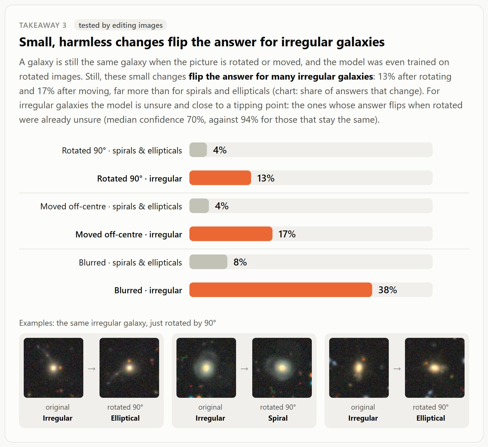
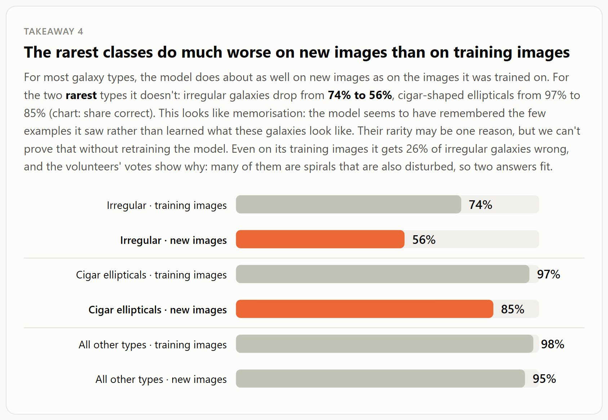
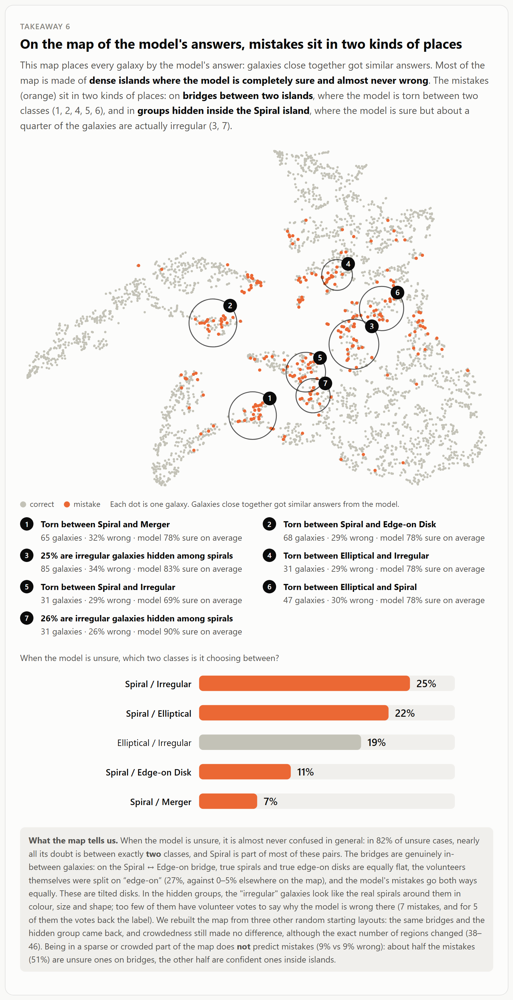

# Phase I: How does the model behave? (AI-aided pair)

## 1. Model, data and approach

**Model.** [zev-walker/astrovision-advanced](https://huggingface.co/zev-walker/astrovision-advanced) is a Zoobot (ConvNeXt-Nano) image classifier. It was fine-tuned on Galaxy10 DECals and sorts galaxy images into five classes: Spiral, Elliptical, Edge-on Disk, Irregular and Merger. (The Irregular class is called "Disturbed Galaxies" in the original Galaxy10 labels; we use the model's name.). The author reports a single number: 92.9% validation accuracy.

**Data.** We used the established Galaxy10 DECals benchmark (17,736 images). We reproduced the author's exact train/validation split (random 20%, seed 42). The findings are based on the **3,547 validation images**, which the model was not trained on. The 14,189 training images serve as a comparison, and are also included in the volunteer-vote check (Takeaway 5) to have more mistakes with votes. Our reproduction gives exactly **92.9%** accuracy, which confirms that our setup matches the author's.

**Black-box approach.** We only used inputs and outputs:
- the model's predicted class probabilities;
- the true labels, including the 10 original Galaxy10 classes that the model merges into 5;
- six properties measured on each input image: apparent size, roundness, colour, core brightness, light from the surroundings, and distance (redshift);
- **two synthetic test sets.** We edited the images in one way at a time (shrink, blur, recolour, squash, rotate, move off-centre, add a neighbour, remove the surroundings) and compared the model's answers before and after. This lets us test causes, not just correlations (705 and 1,115 galaxies);
- a **map of the model's answers** (t-SNE of the output probabilities) with a cluster analysis.

**Visualisations.**
- `vis/findings.html` presents the seven takeaways, with one chart and example galaxies each.
- `vis/explorer.html` is an interactive tool with linked views: a table of answers, a map, a calibration chart, a "what does the answer depend on" chart, and an image gallery.

## 2. Findings

### Takeaway 1: The model often fails to recognise irregular galaxies

Only **56%** of irregular galaxies are recognised, compared with **95%** for all other types. The errors are not random: 24% are called Spiral and 18% Elliptical. Irregular is also one of the rarest classes in the training data (876 training images, compared with 1,443 to 5,200 for the other four classes).

### Takeaway 2: When a galaxy loses detail, the model calls it an elliptical

In the real images, small irregular galaxies are called Elliptical much more often than larger ones (35% vs 6%). To find the cause, we edited 250 spirals.
- **Shrinking** them to half size raises "Elliptical" answers from 0.8% to **14%**.
- **Blurring** them at the same size raises them to **10%**.
- Real ellipticals are not affected (95% stay Elliptical).

So the cause is the **loss of detail**, not size itself. Without visible arms or irregular structure, a galaxy looks like a smooth blob, which is what the model has learned to call an elliptical.

### Takeaway 3: Small, harmless changes flip the answer for irregular galaxies

Rotating an image or moving the galaxy off-centre doesn't change what the galaxy is, and the model was even trained on rotated images. Still, these edits change the answer for irregular galaxies far more often than for spirals and ellipticals:

| Edit | Irregular galaxies | Spirals and ellipticals |
|---|---|---|
| rotating 90° | **13%** | 4% |
| moving off-centre | **17%** | 4% |
| blurring | **38%** | 8% |

The model's decisions for irregular galaxies sit close to a tipping point: the galaxies whose answer flips when rotated were already unsure (median confidence 70%, against 94% for those whose answer stays the same).

### Takeaway 4: The rarest classes do much worse on new images than on training images

For most types, accuracy on new images is close to accuracy on training images (98% vs 95%). For the two rarest types it is not:
- irregular galaxies drop from **74% to 56%**;
- cigar-shaped ellipticals drop from **97% to 85%**.

This looks like memorisation: the model seems to have remembered the few examples it saw rather than learned what these galaxies look like. Their rarity may be one reason, but proving that would require retraining the model, which is outside Phase I. Even on its own training images it gets 26% of irregular galaxies wrong. The volunteers' votes (see Takeaway 5) explain why: many irregular galaxies are spirals that are also disturbed, so two answers fit.

### Takeaway 5: The model is often very sure even when it is wrong

Averaged over all predictions, the model's confidence matches its accuracy well: the average calibration gap is 2%. But **86 of its 252 mistakes (34%)** are made with at least 90% confidence, so confidence cannot be used to catch them. 39 of these 86 are irregular galaxies.

**Are these mistakes really wrong labels?** Galaxy10's labels come from Galaxy Zoo volunteer votes, and the vote counts are public for about 45% of the galaxies (Galaxy Zoo DECaLS, Walmsley et al. 2022). For each of the model's 202 mistakes that have votes (82 on validation and 120 on training images), we compared how many volunteers supported the label with how many supported the model's answer:

| Volunteers' verdict | Share of mistakes |
|---|---|
| votes back the label, so the model is wrong | 54% |
| volunteers were split | 18% |
| both answers fit | 17% |
| votes back the model, so the label looks wrong | 10% |

So **wrong labels explain only about 1 in 10 mistakes.** For irregular galaxies, no mistake had votes backing the model. Instead, when the model calls a irregular galaxy a spiral, most volunteers had seen *both* the disturbance (68%) and spiral arms (51%). These are disturbed spirals: the five classes force one answer for a galaxy that is both.

An earlier visual impression, that about 16 of the 40 most confident mistakes looked mislabelled, overstated label noise. For the 15 of those 40 that have votes, only 3 have votes backing the model.

### Takeaway 6: On the map of the model's answers, mistakes sit in two kinds of places

We clustered the map of the model's answers (HDBSCAN, about 40 regions). Most of the map is **dense islands where the model is sure and almost never wrong**. The mistakes sit in two kinds of places.

1. **Bridges between two classes,** where the model hesitates between exactly two answers.
   - When the model is unsure, in **82%** of cases almost all its doubt is split between just two classes, and Spiral is part of most of these pairs.
   - The bridges contain genuinely in-between galaxies. On the Spiral ↔ Edge-on bridge, true spirals and true edge-on disks are equally flat, the volunteers themselves were split on "edge-on" (27%, against 0–5% elsewhere on the map), and the mistakes go both ways equally. These are tilted disks.
2. **Groups hidden inside the Spiral island,** where the model is confident but about a quarter of the galaxies are labelled irregular.
   - These "irregular" galaxies look like the spirals around them in colour, size and roundness. Too few have volunteer votes to say why the model is wrong here (7 mistakes; for 5 of them the votes back the label).
   - The mix splits into separate sub-groups that behave differently: the same share of irregular galaxies, but different confidence (69%, 83% and 90%).

**Density does not explain the errors.** The sparsest and the densest fifth of the map have about the same error rate (8–9%). About half the mistakes are unsure ones on bridges; the other half are confident ones inside islands.

### Takeaway 7: What does not confuse the model

Several factors looked like they might matter, so we tested them directly. None of them changed the answers:

| Change | Measure | Before | After |
|---|---|---|---|
| Red irregular galaxies made bluer | called Elliptical | 33% | 32% |
| Round ellipticals squashed flat | called Edge-on | 0% | 1.5% |
| Small galaxy added next to spirals | called Merger | 0.8% | 0.8% |
| Surroundings removed around mergers | still called Merger | 91% | 90% |
| Distance, nearest vs farthest fifth (real images) | answered correctly | 93% | 92% |

Colour is the important case. In the real images, red irregular galaxies *are* called Elliptical far more often than blue ones (33% vs 2%), so it looked as if the model judges by colour. The test shows it doesn't. The volunteers do call red irregular galaxies "smooth" more often than blue ones (37% vs 28%), so a smoother shape, not the colour itself, is the likely reason. This shows why we tested patterns rather than only observing them.

## 3. Confidence and limitations

- **High confidence:** the measured effects in takeaways 1–4 and 7. Two explanations are interpretations rather than tested results: that rarity causes the weak rare classes, and that the gap in takeaway 4 is memorisation. Each rests on hundreds of images, holds on both the training and the validation data, and in most cases the cause was tested by editing images.
- **Medium confidence:** takeaway 6. We rebuilt the map from three other random starting layouts: the same bridges, the hidden group in the Spiral region and the density result came back each time, but the exact number of regions changed (38–46), so we report the structure, not the counts.
- **Checked with volunteer votes:** wrong labels explain only about 10% of the mistakes. This rests on the 45% of galaxies with public votes and on an approximate mapping from the Galaxy Zoo questions to our five classes (see `src/volunteer_votes.py`).
- **Measurements are rough proxies.** Size, roundness and colour are measured with simple image statistics, and atmospheric blur makes small galaxies look rounder.
- **Edited images can contain artefacts.** We checked every edit visually before running the tests, and fixed two artificial-looking edits.
- **Possible pretraining overlap.** The model's encoder was pretrained on the same sky survey, so it may have seen validation images before. This could inflate the 92.9%.

## 4. Use of AI in this phase

We used Claude Code throughout, for reading the model's code, building the pipeline and visualisations, suggesting analyses, and running the image-editing tests. All prompts, decisions, failure patterns and best practices are recorded in [`../ai-interactions/ai-use-log.md`](../ai-interactions/ai-use-log.md), and our reflection is in [`../ai_reflection_midpoint.md`](../ai_reflection_midpoint.md).

The most important effect of AI assistance on the analysis was the suggestion to **test patterns by editing images**. This refuted the colour hypothesis and refined the size hypothesis into "loss of detail".
